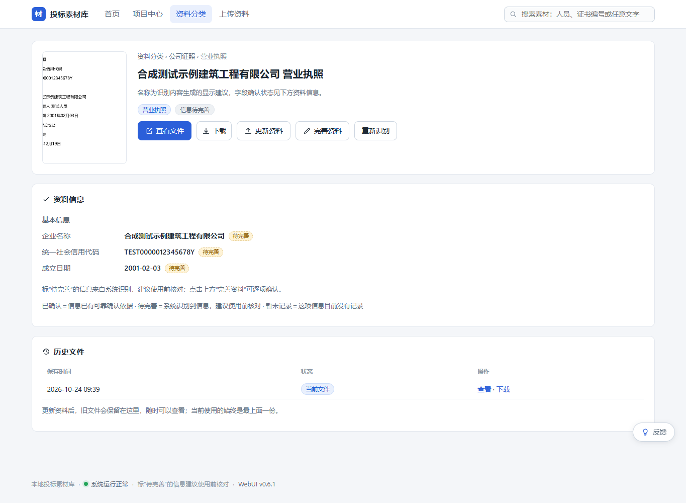
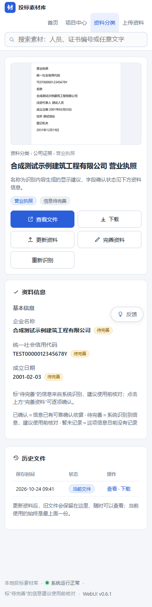
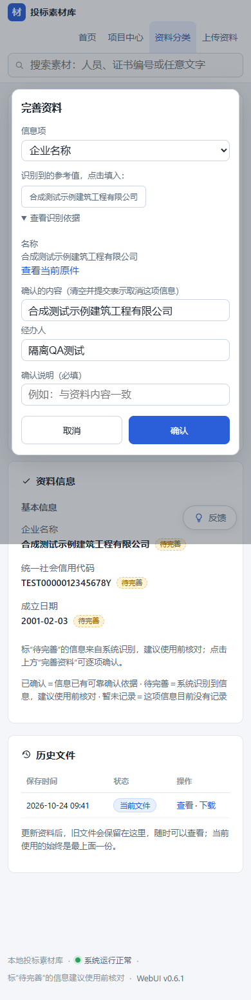

# v0.6.1 Material Upload Extraction Repair

MATERIAL UPLOAD EXTRACTION REPAIR = PASS

本分支修复普通 WebUI 上传营业执照时“有 OCR 文字、没有结构化字段”的问题。企业名称、统一社会信用代码、成立日期只进入待完善候选；用户仍需在“完善资料”中逐项确认。没有部署，也没有修改生产资料。

## 版本与门禁

```text
BASE_HEAD = 74be617a38b0dd0fe094e5ff621c4d8e7188766c
BRANCH = material-upload-extraction-repair
BRANCH_HEAD = ee0eb41d6eedcdeb0557cdf8957ad02d61bdd0eb (validated implementation HEAD)
WORKTREE = D:\workSpace\bmc-upload-repair
WEBUI_VERSION = 0.6.1
PRODUCTION_WEBUI_VERSION = 0.6.0
SCHEMA_VERSION = jty-mcp-0.6.0
SCHEMA_CHANGED = NO
ROOT_CAUSE_WEB_UPLOAD_CONTEXT = CONFIRMED
ROOT_CAUSE_BUSINESS_LICENSE_EXTRACTOR = CONFIRMED
PRODUCTION_OCR_RAW_TEXT_CHECK = PASS
OCR_TEXT = PASS
STRUCTURED_EXTRACTION = PASS
BUSINESS_LICENSE_ENTERPRISE_NAME = PASS
BUSINESS_LICENSE_CREDIT_CODE = PASS
BUSINESS_LICENSE_ESTABLISHED_ON = PASS
STAMP_DATE_FALSE_POSITIVE_TEST = PASS
WEB_UPLOAD_ENHANCED_EXTRACTION = PASS
REEXTRACT_WITHOUT_REUPLOAD = PASS
ORIGINAL_SHA_UNCHANGED = PASS
VERIFIED_FACTS_UNCHANGED = PASS
TITLE_UX = PASS
REAL_UMI_INTEGRATION = PASS
FULL_REGRESSION = PASS
DESKTOP_QA = PASS
MOBILE_QA = PASS
PROJECT_REGRESSION = PASS
LARGE_DOCUMENT_REGRESSION = PASS
BUSINESS_LICENSE_EXTENDED_FIELDS = BACKLOG
MATERIAL_UPLOAD_WHITELIST_UNCHANGED = PASS
SENSITIVE_SCAN = PASS
ROOT_DRIVE_TEMP_SCAN = PASS
PRODUCTION_TOUCHED = NO
```

`BRANCH_HEAD` 记录验证过的实现提交。报告单独提交在其后；最终推送 HEAD 可用 `git rev-parse origin/material-upload-extraction-repair` 取得，并随交付消息给出，避免在报告里伪造包含自身内容的提交哈希。

## 生产只读调查结论（仅保留命中状态）

```text
AFFECTED_PRODUCTION_MATERIAL_ID = 1100
CURRENT_EXTRACTION_RUN_ID = 1294
CURRENT_CANDIDATE_COUNT = 0
OCR_RAW_TEXT_CONTAINS_EXPECTED_FIELDS = YES
OCR_RAW_TEXT_CONTAINS_ENTERPRISE_NAME = YES
OCR_RAW_TEXT_CONTAINS_CREDIT_CODE = YES
OCR_RAW_TEXT_CONTAINS_ESTABLISHED_DATE = YES
```

此前只读调查已确认：生产 Material 1100 的 OCR raw text 包含企业名称、统一社会信用代码和成立日期，但结构化候选为 0。公开报告仅保留是否命中的结论，不复制生产标题、企业标识、成立日期或原始正文。本次公开仓库卫生收尾不再读取生产，也不对该材料执行任何操作。

普通 WebUI 原先发送 `kind=material`、subtype、title 等参数，没有 `source_metadata`。workflow 因此选择旧 `candidate_values()`；该 helper 只有 certificate 有效期和 contract 金额的早期分支，`kind=material` 更无法触发这两支。批量入口带 source context，才会调用 `business.extract_candidates()`。但增强提取器原来也没有营业执照的三个字段分支。两处缺失叠加，便出现 run 成功但候选为 0。

上轮只读核对摘要及生产指纹留在被 Git 忽略的本地审计中；公开报告不附生产原文。本次只核对开发 worktree 的功能文件及测试证据，不重新读取生产，生产材料没有执行 reextract。

## 实现与事实边界

所有 Material import、replace、batch import 都经 workflow 调用同一个 `business.extract_candidates()`；没有 metadata 时传空 context，彻底移除“有无 metadata 决定提取器”的分流。reextract 原本已调用增强提取器，本轮继续复用同一实现。保留早期明确货币金额和证书有效期区间的能力，并通过现有类型字段验证器过滤输出。

WebUI 服务端仅从清理后的文件 basename、用户显示标题构建 context：`source_origin=webui`、`source_filename`、`source_relative_path`、`source_title`、`title_origin`。这些都是未确认上下文；不接收浏览器提供的路径、OCR 正文、候选或任意 source metadata。营业执照企业名称和代码不从文件名推断。

营业执照规则使用明确标签：名称/名 称、统一社会信用代码、成立日期。名称和代码可移除 OCR 多余空格；代码最终必须通过现有 credit validator，日期使用现有 date validator。匹配使用 NFKC 文本并映射回原始 OCR 字符偏移，保存原始 evidence。公司名称排除营业执照、登记机关、公示系统网址等页头页脚。无标签的 18 位串不作为信用代码；无“成立日期”上下文的盖章日期不作为成立日期。

以下仅为合成测试 fixture 的预期值，不是生产字段：

```text
enterprise_name = 合成测试示例建筑工程有限公司
unified_social_credit_code = TEST0000012345678Y
established_on = 2001-02-03
review_status = pending
```

候选保留 raw_value、normalized_value、evidence_span、run_id；source_file_id 由 extraction_run 关联当前原件。新运行标记规则版本 `2.1.5/v0.6.1` / `2.1.5/v0.6.1-reextract`。OCR 不写 verification_event，也不写 org.name / org.unified_social_credit_code / org.established_on。只有既有人工核验流程能写正式字段。“完善资料”对话框新增可展开的识别依据及当前原件链接。

普通上传补充 context 后，人员证书 replace 仍须将旧人员关联改为 relation_pending；本轮相应调整该条件，防止显示 context 被误当成新人员证据。source context 也按 current original 限定，避免新版本复用旧文件的标题提示。

## 名称与有效期

资料名称改为可选。用户填写时保留其标题；未填写、空字符串或全空白时，由服务端使用文件名 stem，确保 material.title 非空。旧前端继续提交 title 仍可使用。

对于未填写标题的营业执照，当前原件若只有一个合理企业名称候选，list/detail 使用 `<企业名称> 营业执照` 显示建议。存储标题仍保留文件名；详情明确标明这是自动显示建议，字段确认状态见资料信息。多个冲突名称时继续显示文件名；自填标题不被覆盖。replace 保留存储标题，不擅自将它变成新自动建议。

营业执照不再突出普通证书式“有效期未记录”，也不强制展示列表有效期列。现有 valid_from / valid_until / long_term_valid 历史字段、人工编辑能力及底层投标有效性规则保留；本轮没有推断营业执照长期有效，也没有放宽 eligible_for_bid。

## 不重新上传的受控修复

详情页“重新识别”经 same-origin POST、异步 WebUI job、manager RPC 执行。浏览器和 CLI 只发送 material_id / actor。manager 在串行锁内从 DB 解析 current original、当前搜索文件、材料类别及当前 source context，校验原件 SHA 和 current version，再提交新 run。

完整且校验通过的当前 OCR 文本可直接复用，复用 raw/jsonl/search 的 file ID、SHA 会写入 run params，标明 `ocr_engine_rerun=false`。缺失、空白或 partial OCR 不被伪装成 complete，改用已有真实 OCR 路径；checksum 不符则拒绝。原内部受控 record/phase reextract 协议仍保留原有明确证据校验。

新 run 仅 supersede 旧 pending candidates；保留 accepted/rejected 历史及 verified facts，不新增 Material、不新增原件、不更改 original version 或 SHA，也不新增 verification_event。CLI 面向用户的旧 `--record` 入口改为以下两个受控参数，避免由调用方决定当前证据。

**以下仅供以后正式部署获批后执行，本轮没有在生产运行：**

```powershell
python -B mcp_v01/cli.py --config config/materials.json reextract --material-id 1100 --actor "实际经办人"
```

也可在材料 1100 详情页点击“重新识别”，输入经办人后等待完成，再通过“完善资料”人工确认。

## 测试与真实依赖

原 176 个测试方法通过 AST 比对全部保留，没有删除或增加 skip；两处固定 POST 路由集合的断言扩充了 `/api/reextract`，其 same-origin 与上传白名单断言保持。

新增测试共 32 个：`test_upload_repair.py` 31 个、`test_upload_repair_integration.py` 1 个。覆盖标签/空格/信用代码拒绝/日期干扰/去重/原始 evidence、各现有类型增强提取复用、服务端 context 与注入边界、旧新前端标题、歧义标题、原件与人工事实保留、旧上传无 context 的重提取、缓存 OCR 校验及 partial 不晋升、CLI 两参数边界。

合成 fixture 由 `upload_repair_support.py` 使用本机中文字体生成清晰 PNG，企业名称为“合成测试示例建筑工程有限公司”、信用代码为 `TEST0000012345678Y`；法定代表人为“测试人员”、住所为“测试地址”、成立日期为 `2001-02-03`。这些都是合成测试数据，未使用生产营业执照图像或复制生产字段。专门加入 `2031年12月19日` 盖章干扰日期。

合成 fixture 的真实 OCR 原文已随分支保存：[real-umi-raw.txt](docs/material-upload-extraction-repair/real-umi-raw.txt)，其中三个目标字符串均已逐项断言。

真实 Umi 版本由复制的 `UmiOCR-data/about.json` 校验为 2.1.5。真实测试经 Web upload worker → named-pipe manager → Umi → 增强提取器 → pending candidates，检查并保存原始 OCR 文本，同时用真实 dowse 完成索引链路；没有以 mock/skip 代替这项集成测试。完整回归中的 Project/large-document 真实依赖测试也继续执行。

本次卫生复验完整回归耗时 770.516 秒，208/208 PASS，FAIL/ERROR/SKIP 均为 0。53 个已批准功能文件指纹不变；仅 fixture 输入和期望值改变，3 个 fixture/测试源码文件在复验期间保持冻结，208 项测试逻辑与方法集合不变。

运行时仅从已有安装只读复制；实际 Umi/dowse 进程、数据库、索引、图片、OCR、TEMP/TMP、截图和浏览器 profile 都在 worktree。测试 Umi 使用独立端口，本轮 helper 选择动态客户端端口范围外的空闲端口；没有修改生产 OCR 配置。

```text
FINAL_TEST_TOTALS = 208 / 208 PASS (176 original + 32 new)
FAIL = 0
ERROR = 0
SKIP = 0
FULL_REGRESSION_ARTIFACT = runs/large-document/regression-20261024-094208/summary.json
REAL_UMI_ARTIFACT = runs/upload-repair/real-29d5a4/real-umi-evidence.json
```

原功能修复阶段曾出现隔离 Umi 副本启动未就绪（尚未进入 OCR），没有将失败运行计为通过；仅调整测试端口不能证明已找到该启动问题的唯一原因。首次完整回归还发现旧路由集合断言未包含新端点，同时修复显式传入空 OCR factory 改变旧故障注入调用默认值的问题，保持原测试注入协议；修正后从头重跑。最终以本报告列出的完整成功运行及最终浏览器 QA 为准，保留早期日志，不用早期失败证据替代门禁。

## 浏览器 QA

Browser plugin not available；使用已安装 Chrome + Python Playwright。测试流为 `/upload` → 选择营业执照 → 名称留空上传 → 真实 OCR → Material 三个待完善字段 → 完善资料候选填入及依据展开 → 取消人工确认 → 重新识别当前文件 → 新 run pending / 原件和人工事件不变。

| 检查 | 1365×900 | 390×844 |
|---|---|---|
| 页面 URL/title 与有效正文 | PASS | PASS |
| 无空白页、错误覆盖层 | PASS | PASS |
| Console / pageerror | PASS，0 条 | PASS，0 条 |
| 名称可选、上传进度、待完善字段 | PASS | PASS |
| 完善资料对话框、当前原件依据 | PASS | PASS |
| 重新识别新 run、原件版本不变 | PASS | PASS |
| 横向 overflow | 无 | 无 |

浏览器测试库关停后的持久状态再次只读核对：2 个 Material、2 个原件/原件版本、4 次 extraction_run、6 个当前 pending candidates、0 个 verification_event。两次重新识别都记录 `ocr_engine_rerun=false`；审计在 `runs/upload-repair/qa-885d1b/durable-state-audit.json`。

QA 临时 URL 为 `http://127.0.0.1:58221`（测试结束已停止）。证据：`runs/upload-repair/qa-885d1b/summary.json`；每种尺寸保存 upload、progress、detail、review-dialog、reextract-progress、reextract-done 共 12 张截图。已人工查看桌面和手机 detail/dialog 截图。移动端控件换行、字段与依据可读，页面无横向溢出。仅覆盖本机 Chrome；未声称覆盖 Safari 或实机拍照。

关键命令为 `python -B mcp_v01/run_project_center_tests.py` 与 `python -B mcp_v01/upload_repair_browser_qa.py`，需显式提供真实 `P05_DOWSE_EXE` / `LARGE_DOC_UMI_EXE`，缺失会失败。浏览器脚本使用本机 Chrome、worktree 内持久 profile、真实 HTTP 上传和 manager。后续可安装 Browser 插件以便在应用内查看 DOM、截图与交互证据。

本次使用 `git diff --check` / staged diff check、公开树敏感模式扫描及根盘新增条目扫描。53 个已批准功能文件的指纹、208 项测试方法集合、fixture 冻结证明及公开树审计保存在 `runs/public-fixture-sanitization/`；本轮不访问生产做指纹复查。

## 未扩展字段与后续设计

`legal_representative`、`registered_capital`、`registered_address`、`business_scope` 不在当前正式 Material 可核验字段契约中（schema/typed vocabulary 已检查）。没有增加 material_attr、万能 JSON 或无类型 kv，也没有把这些内容偷偷写入 generic EAV。

后续建议单独设计有类型的 business_license_detail / 企业登记版本模型：法定代表人使用明确角色及证据的人名或人员关系；注册资本定义币种、金额单位、定点数及大写金额原文；住所与经营范围为明确文本列。每项都应有版本/原件证据、候选与人工确认规则、历史变更和迁移测试，先 review 方案再升级 schema。

## Changed files（原 v0.6.1 功能修复）

- `mcp_v01/jty_materials/business.py`：营业执照规则、校验与原始证据、current source context。
- `mcp_v01/jty_materials/workflow.py`：所有 import/replace 统一提取器、保留人员换版语义、规则版本。
- `mcp_v01/jty_materials/reextract.py`：manager 解析当前证据、完整 OCR 复用、SHA/版本检查、规则版本。
- `mcp_v01/jty_materials/manager.py`：受控 reextract_current action，复用现有串行写入/索引发布。
- `mcp_v01/cli.py`：用户重识别仅允许 material ID / actor。
- `mcp_v01/webui/uploads.py`：服务端 context、安全标题 fallback、异步重识别 job、清理改名 staging 文件。
- `mcp_v01/webui/api.py`、`app.py`：名称可选和 same-origin 重识别 API。
- `mcp_v01/webui/display.py`、`service.py`：当前原件唯一名称候选的显示建议。
- `mcp_v01/webui/pages.py`、`static/app.js`：上传 UX、候选依据、重识别入口及进度。
- `mcp_v01/webui/catalog.py`：营业执照不突出普通有效期缺失。
- `mcp_v01/webui/__init__.py`：WebUI 0.6.1。
- `mcp_v01/test_mobile_ui.py`、`test_p05.py`：新增端点纳入原有路由防护断言。
- `mcp_v01/test_upload_repair.py`、`test_upload_repair_integration.py`：32 个新测试。
- `mcp_v01/upload_repair_support.py`、`upload_repair_browser_qa.py`：合成 fixture、真实运行时隔离及双尺寸 QA。
- `docs/material-upload-extraction-repair/`：三张合成 fixture 的截图及真实 Umi 原始文本，便于远程 review。
- `README.md`、`docs/webui.md`：版本、上传名称、受控重新识别与合成样例边界说明。
- `MATERIAL_UPLOAD_EXTRACTION_REPAIR_REPORT.md`：本报告。

Project Center / Project Document / Large Document 的 schema、索引、提取、搜索源码未修改。普通 Material 上传仍仅 PDF/PNG/JPG/JPEG；Project File 白名单与 Project Document 语义未动。未接入 LLM/Vision/Agent/Embedding/RAG，未改 main、未部署、未迁移生产、未对生产执行重新识别。

## 公开仓库卫生收尾

```text
HYGIENE_BASE_HEAD = 3da7ee4a506593c6de15b1f48fab0f6b703690c3
FUNCTIONAL_CODE_REVIEW = APPROVED
PUBLIC_FIXTURE_SANITIZATION = PASS
PUBLIC_REPO_REAL_COMPANY_NAME_HITS = 0
PUBLIC_REPO_REAL_CREDIT_CODE_HITS = 0
SYNTHETIC_FIXTURE_COMPANY = 合成测试示例建筑工程有限公司
SYNTHETIC_FIXTURE_CREDIT = TEST0000012345678Y
SYNTHETIC_FIXTURE_ESTABLISHED_ON = 2001-02-03
HYGIENE_REAL_UMI_INTEGRATION = PASS
HYGIENE_FULL_REGRESSION = 208 / 208 PASS; FAIL=0 ERROR=0 SKIP=0
HYGIENE_DESKTOP_QA = PASS
HYGIENE_MOBILE_QA = PASS
FUNCTIONAL_CODE_CHANGED = NO
PRODUCTION_TOUCHED = NO
```

公开 Git 不保留真实生产字段，即使该企业标识属于公开登记信息。本次只替换 fixture 常量、测试输入/期望值、文档示例及重新生成的 OCR/截图；已批准的功能实现保持原样。当前 credit validator 只执行 `[0-9A-Z]{18}` 格式检查，没有校验位算法；合成代码含明确 `TEST` 标记，18 位并通过现有 `validate_value`，未绕过验证器。

扫描范围是当前 Git tracked/staged 文件与本次最终提交树，涵盖文本、NFKC/去空白变体和重新生成的截图可见内容。历史提交不改写；本节零命中结论不扩张到祖先提交、生产工作区或被忽略的本地 runs/audit。此前生产只读检查确认 OCR 包含目标字段；公开报告和 fixture 不再复制真实生产标识或成立日期。

此次卫生修正实际修改文件：

- `mcp_v01/upload_repair_support.py`：合成企业、代码和日期；synthetic fixture only 注释。
- `mcp_v01/test_upload_repair.py`、`test_upload_repair_integration.py`：仅替换测试输入及期望字符串，测试逻辑和 208 项方法集合不变。
- `README.md`、`docs/webui.md`：删除公开企业标识可用例外，明确 synthetic-only 原则。
- `docs/material-upload-extraction-repair/real-umi-raw.txt`：重新生成的真实 Umi 合成 fixture OCR。
- 同目录 `desktop-detail.png`、`mobile-detail.png`、`mobile-review-dialog.png`：合成 fixture 重新 QA 生成。
- `MATERIAL_UPLOAD_EXTRACTION_REPAIR_REPORT.md`：生产字段抽象为命中结论，更新验证与扫描证据。

浏览器卫生复验：`runs/upload-repair/qa-885d1b/summary.json` 与 `durable-state-audit.json`，两种 viewport 及 12 张中间状态截图全部使用合成数据。公开三张截图与该 run 输出逐字节一致，已人工查看；PNG 元数据无真实标识。

泛化扫描未发现手机号、人员身份证、私钥/token 或 DB/archive dump；4 处长数字命中均为既有单元测试信用代码占位值，1 处路径命中是既有公开工作区根目录说明，均经人工复核，不属于新增生产敏感内容。

卫生复验完整回归：`runs/large-document/regression-20261024-094208/summary.json`；真实 Umi：`runs/upload-repair/real-29d5a4/real-umi-evidence.json`。公开 `real-umi-raw.txt` 与本次真实 OCR 字节一致，三个目标字符串均已断言通过。

本地卫生审计：`runs/public-fixture-sanitization/approved-functional-manifest.json`、`qa-and-test-preservation.json`、`real-umi-proof.json`、`audit-worktree.json`、`audit-index.json`、`audit-head.json`。仅 Git 当前树/暂存树/最终提交树纳入零命中统计，截图同时以新 QA 原始文件字节、可见内容及 PNG 元数据复核；旧生产工作区和被忽略的运行目录不属于公开扫描范围。

## 新增测试清单

- `LicenseExtractorTests.test_labeled_company_name`
- `LicenseExtractorTests.test_spaced_labels_and_values`
- `LicenseExtractorTests.test_credit_with_ocr_spaces`
- `LicenseExtractorTests.test_invalid_credit_rejected`
- `LicenseExtractorTests.test_credit_requires_label`
- `LicenseExtractorTests.test_established_date`
- `LicenseExtractorTests.test_unrelated_stamp_date_not_selected`
- `LicenseExtractorTests.test_invalid_date_not_selected`
- `LicenseExtractorTests.test_duplicate_candidates_deduped`
- `LicenseExtractorTests.test_original_evidence_preserved_after_normalization`
- `LicenseExtractorTests.test_company_cannot_be_footer_or_license_heading`
- `LicenseExtractorTests.test_filename_is_not_enterprise_evidence`
- `LicenseExtractorTests.test_existing_types_share_extractor`
- `UploadRepairTests.test_web_upload_enhanced_context_and_evidence_pending`
- `UploadRepairTests.test_supplied_title_respected`
- `UploadRepairTests.test_empty_whitespace_title_fallback_and_suggestion`
- `UploadRepairTests.test_ambiguous_name_keeps_filename`
- `UploadRepairTests.test_non_license_fallback_nonempty`
- `UploadRepairTests.test_web_upload_existing_types_reuse_enhanced_extraction`
- `UploadRepairTests.test_api_optional_title_and_no_trusted_metadata_injection`
- `UploadRepairTests.test_worker_context_is_server_constructed`
- `UploadRepairTests.test_reextract_same_original_manual_facts_and_pending_candidates`
- `UploadRepairTests.test_reextract_accepts_only_id_actor_and_checks_sha`
- `UploadRepairTests.test_cli_reextract_sends_only_id_and_actor`
- `UploadRepairTests.test_legacy_upload_without_source_context_can_reextract`
- `UploadRepairTests.test_reextract_reuses_current_ocr_with_checked_provenance`
- `UploadRepairTests.test_reextract_rejects_changed_cached_ocr_bytes`
- `UploadRepairTests.test_partial_ocr_is_not_promoted_to_complete_by_reuse`
- `UploadRepairTests.test_web_replace_preserves_custom_title_and_demotes_person_relation`
- `UploadRepairTests.test_replace_and_import_use_same_enhanced_extractor`
- `UploadRepairTests.test_detail_pending_title_note_no_expiry_warning_and_optional_form`
- `UploadRepairIntegrationTests.test_real_umi_web_upload_pending_and_reextract_without_new_original`

## Screenshots

以下截图均来自合成测试资料。其余进度和中间状态保存在 worktree 的 runs 目录。




